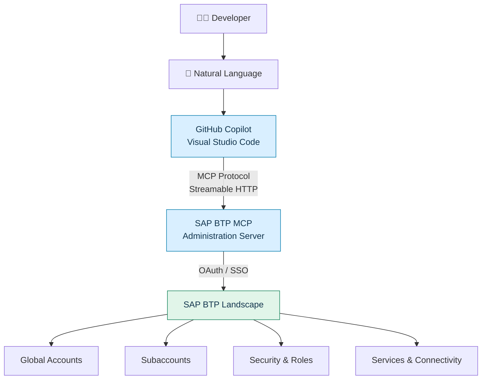
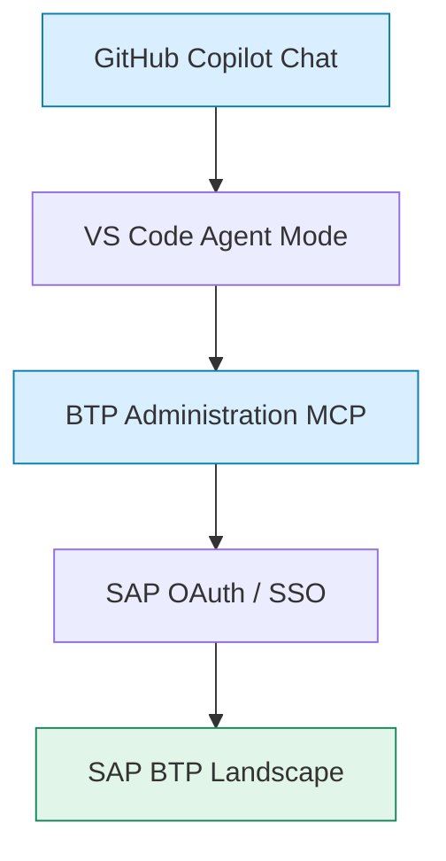

<div align="center">

# 🚀 SAP BTP Administration MCP Server
### Connect SAP BTP with GitHub Copilot in Visual Studio Code

<p>
  <b>Manage your SAP BTP landscape using natural language and AI-powered assistance.</b>
</p>

<p>
  
  
  
  
</p>

<p>
  <a href="#-overview">Overview</a> •
  <a href="#-architecture">Architecture</a> •
  <a href="#-setup-guide">Setup Guide</a> •
  <a href="#-examples">Examples</a> •
  <a href="#-troubleshooting">Troubleshooting</a>
</p>

</div>

---

## 📌 Overview

The **Model Context Protocol (MCP)** enables AI assistants to communicate with external systems through a standardized interface.

SAP provides an MCP Server for SAP BTP Administration that allows compatible AI clients, including **GitHub Copilot in Visual Studio Code**, to discover and invoke SAP BTP administrative tools.

This integration transforms GitHub Copilot into a natural-language interface for supported SAP BTP administration operations.

Instead of manually navigating the SAP BTP Cockpit or executing repetitive CLI commands, administrators can interact with their SAP landscape directly through AI-powered conversations.

### 🎯 What are we building?

We are connecting four components:

| Component | Purpose |
|---|---|
| ☁️ SAP BTP Administration MCP Server | Exposes SAP BTP administrative capabilities |
| 💻 Visual Studio Code | Hosts the MCP client |
| 🤖 GitHub Copilot | Discovers and invokes MCP tools |
| 🔐 SAP Authentication | Provides authorized access to SAP BTP |

### ✨ Key Capabilities

- Explore SAP BTP global accounts and subaccounts.
- Discover available SAP BTP regions.
- Inspect service entitlements and quotas.
- Explore users, roles and role collections.
- Access supported connectivity and destination administration capabilities.
- Perform supported administrative operations through natural language.

> **Note:** Actual capabilities depend on the tools exposed by SAP, your account type and your assigned permissions.

---

## 📚 Table of Contents

| # | Section |
|---|---|
| 01 | [Architecture](#-architecture) |
| 02 | [Prerequisites](#-prerequisites) |
| 03 | [MCP Server Details](#-sap-btp-mcp-server-details) |
| 04 | [Configure MCP in VS Code](#-setup-guide) |
| 05 | [Start and Verify Connection](#-verify-the-connection) |
| 06 | [Test with GitHub Copilot](#-examples) |
| 07 | [Alternative: Direct Connection](#-alternative-direct-connection) |
| 08 | [Troubleshooting](#-troubleshooting) |
| 09 | [Security Considerations](#-security-considerations) |
| 10 | [Final Outcome](#-final-outcome) |
| 11 | [References](#-references) |

---

## 🏗️ Architecture

The integration follows a simple communication flow:



### 🔄 How It Works

1. The developer sends a natural-language request through GitHub Copilot.
2. GitHub Copilot discovers available tools exposed by the MCP server.
3. Communication takes place through the MCP protocol using Streamable HTTP.
4. SAP authentication authorizes access to the BTP landscape.
5. The MCP server exposes supported administrative operations to the AI client.

---

## 📋 Prerequisites

Before starting, ensure you have the following:

| Requirement | Description |
|---|---|
| Visual Studio Code | Latest supported version |
| GitHub Copilot | Copilot extension enabled |
| GitHub Account | Account with Copilot access |
| SAP BTP Account | Access to an SAP BTP global account |
| SAP Identity | User with appropriate administrative permissions |
| MCP Support | VS Code version supporting MCP servers |

### Required VS Code Extensions

- GitHub Copilot
- GitHub Copilot Chat

---

## 🌐 SAP BTP MCP Server Details

SAP provides a dedicated MCP endpoint for BTP Administration.

### Available Endpoints

| Authentication | Endpoint |
|---|---|
| **Single Sign-On (SSO)** ⭐ | `https://sso.mcp.btp.cloud.sap/mcp` |
| Direct Connection | `https://proxy.c-769d49e.kyma.ondemand.com/mcp` |

> **Recommended:** Use the SSO-based connection as your starting point.

### Supported Administration Domains

| Domain | Capabilities |
|---|---|
| Accounts | Global accounts, directories and subaccounts |
| Security | Users, roles, role collections and trust |
| Services | Entitlements, quotas and subscriptions |
| Connectivity | Destinations and connectivity configurations |

The MCP server dynamically exposes its available tools to the AI client. Individual tools do not need to be manually registered.

---

## ⚙️ Setup Guide

### Step 1 — Open Your Project

Open your application or workspace in Visual Studio Code.

### Step 2 — Create the MCP Configuration

Inside your project, create the following folder and file:

```text
your-project/
│
├── .vscode/
│   └── mcp.json
│
└── README.md
```

Alternatively:

1. Open the Command Palette using `Ctrl + Shift + P`.
2. Search for `MCP: Open User Configuration` or use the workspace MCP configuration.
3. Create or open the appropriate MCP configuration file.

### Step 3 — Configure the SAP BTP MCP Server

Add the following configuration to `.vscode/mcp.json` using the configuration format from the SAP Community guide:

**File: `.vscode/mcp.json`**

```json
{
  "mcpServers": {
    "BTP Administration": {
      "type": "streamableHttp",
      "url": "https://sso.mcp.btp.cloud.sap/mcp"
    }
  }
}
```

Save the file.

> **Configuration compatibility:** VS Code MCP configuration schemas can vary by version. If your installation expects the newer `servers` root property or explicit OAuth configuration, use the schema accepted by your installed VS Code version.

### Step 4 — Configure OAuth Client ID

When VS Code requests the OAuth Client ID, enter:

```text
e789ba01-5612-47ee-bfe7-79e26411c1ca
```

This is the client ID published in the SAP Community guide.

VS Code stores the OAuth client configuration, so it should not need to request it again for subsequent connections.

### Step 5 — Authenticate with SAP

1. Start the MCP connection from VS Code.
2. When prompted, open the browser authentication window.
3. Sign in using your SAP identity.
4. Complete the OAuth/SSO authorization flow.
5. Return to Visual Studio Code.

<details>
<summary><b>🔐 What happens during authentication?</b></summary>

The OAuth/SSO flow establishes an authenticated connection between your VS Code MCP client and the SAP BTP Administration MCP server.

The server operates within the permissions of your authenticated SAP identity.

</details>

---

## ✅ Verify the Connection

### Step 1 — Open GitHub Copilot Chat

Open Copilot Chat from the VS Code sidebar.

### Step 2 — Select Agent Mode

Switch the chat interface to **Agent Mode**.

Agent Mode allows Copilot to discover and invoke available MCP tools.

### Step 3 — Check MCP Server Status

Open the MCP server management interface in VS Code.

You should see an entry similar to:

```text
BTP Administration

Status: Connected
Transport: Streamable HTTP
Authentication: OAuth / SSO
```

The exact status labels depend on your VS Code version.

### Step 4 — Verify Available Tools

Inspect the tools exposed by the BTP Administration MCP server.

The available tools depend on:

- SAP-side support.
- Your SAP BTP permissions.
- The operations exposed by the service.
- Account and tenant capabilities.

---

## 🤖 Examples

Once the connection is active, you can interact with SAP BTP using natural language.

Here are some example prompts for GitHub Copilot.

### 1. Global Account

```text
Show me the global accounts associated
with my SAP identity.
```

### 2. Subaccounts

```text
List all subaccounts available in my
SAP BTP global account.
```

### 3. Regions

```text
Show the available SAP BTP regions.
```

### 4. Service Entitlements

```text
Show the service entitlement capacity
for my global account.
```

### 5. User Management

```text
List users assigned to my SAP BTP
subaccount.
```

### 6. Role Collections

```text
Show all available role collections
in my production subaccount.
```

### 7. Create a Subaccount

```text
Create a development subaccount
in the EU10 region.

First show me the configuration
and ask for confirmation before
creating the subaccount.
```

> ⚠️ **Important:** Administrative operations can modify your SAP environment. Review the target, scope and consequences before approving any write or destructive operation.

---

## 🔌 Alternative: Direct Connection

If you cannot use SSO, SAP also provides a direct connection endpoint.

### Requirements

- SAP username and password.
- Base64-encoded credentials.
- IAS tenant subdomain.

### Step 1 — Encode Your Credentials

Expected format:

```text
username:password
```

**macOS / Linux**

```bash
echo -n "<username>:<password>" | base64
```

**Windows PowerShell**

```powershell
[Convert]::ToBase64String(
  [Text.Encoding]::UTF8.GetBytes(
    '<username>:<password>'
  )
)
```

### Step 2 — Configure VS Code

Create or update `.vscode/mcp.json`:

```json
{
  "inputs": [
    {
      "id": "btp-credentials",
      "type": "promptString",
      "description": "Base64-encoded BTP credentials",
      "password": true
    },
    {
      "id": "btp-origin",
      "type": "promptString",
      "description": "IAS tenant subdomain"
    }
  ],
  "mcpServers": {
    "BTP Administration": {
      "type": "streamableHttp",
      "url": "https://proxy.c-769d49e.kyma.ondemand.com/mcp",
      "headers": {
        "Authorization": "Basic ${input:btp-credentials}",
        "X-Platform-Origin": "${input:btp-origin}"
      }
    }
  }
}
```

VS Code prompts for the credentials when establishing the connection.

According to the SAP guide, these prompted values are not stored on disk.

> 🔒 **Security recommendation:** Prefer SSO wherever possible. Base64 is encoding, not encryption. Never commit credentials, access tokens or sensitive configuration values to Git.

---

## 🛠️ Troubleshooting

### Issue 1 — MCP Server Is Not Connecting

Check:

- Your internet connection.
- The MCP endpoint URL.
- Whether your VS Code version supports remote MCP servers.
- Whether the authentication flow completed successfully.

**Solution:** Try restarting the MCP server from VS Code.

### Issue 2 — OAuth Authentication Problems

Check the OAuth client configuration.

```text
e789ba01-5612-47ee-bfe7-79e26411c1ca
```

Some VS Code versions or OAuth redirect configurations may require an explicit OAuth client configuration.

**Newer VS Code configuration example:**

```json
{
  "servers": {
    "BTP Administration": {
      "type": "http",
      "url": "https://sso.mcp.btp.cloud.sap/mcp",
      "oauth": {
        "clientId": "e789ba01-5612-47ee-bfe7-79e26411c1ca"
      }
    }
  }
}
```

> Use this only if it matches the schema supported by your installed VS Code version.

### Issue 3 — Only One MCP Tool Is Visible

A successful connection does not necessarily mean every administrative operation is available.

Check:

- The tools listed by the MCP server.
- Your SAP BTP user permissions.
- The capabilities supported by your account and tenant.
- Whether the issue is related to SAP-side tool availability.

The SAP Community discussion includes reports of clients showing only `Navigation-buildLink` despite a successful connection. This should be investigated rather than assuming all tools are available.

### Issue 4 — Some Operations Fail

Some operations may require additional authentication or environment-specific configuration.

For example, Cloud Foundry-related operations may require a separate Cloud Foundry login:

```bash
cf login -a <api.cf.<region>.hana.ondemand.com>
```

A successful MCP OAuth connection does not automatically authenticate every underlying SAP service or environment.

### Issue 5 — SAP BTP Trial Limitations

Some administrative capabilities may not be available for trial accounts.

Verify the operation against a supported account and check the permissions associated with your SAP identity.

### 🆘 SAP Support

If the problem persists, raise an SAP support request using:

```text
Component: BC-CP-ADMINMCP
```

---

## 🔐 Security Considerations

The MCP server operates with the scope of your authenticated SAP user identity.

This is particularly important when one SAP identity is associated with multiple global accounts.

### Security Best Practices

- ✅ Use a dedicated SAP identity for testing where possible.
- ✅ Avoid using a productive administrator identity for experiments.
- ✅ Review OAuth authorization and granted permissions.
- ✅ Do not expose credentials in source code.
- ✅ Avoid automatic approval of sensitive administrative operations.
- ✅ Review Copilot's proposed actions before executing them.
- ✅ Test write operations in a non-production environment first.

> **Production safety:** Never blindly approve AI-generated administrative operations against a production SAP BTP landscape.

---

## 🎉 Final Outcome

After completing this integration, your development environment will have the following architecture:



### What Can You Do Now?

| Capability | Interaction |
|---|---|
| Account Management | Explore global accounts and subaccounts |
| Region Discovery | Discover available BTP regions |
| Service Administration | Inspect entitlements and quotas |
| Security Administration | Explore users and role collections |
| Connectivity | Inspect supported destinations and configurations |

You can now use **GitHub Copilot as a natural-language interface for supported SAP BTP administration operations**.

Instead of manually navigating different SAP BTP Cockpit screens, you can ask questions, inspect account information and perform supported administrative tasks through MCP.

---

## 🔗 References

| Resource | Link |
|---|---|
| SAP Community Guide | [Connecting the MCP Server for SAP BTP Administration](https://community.sap.com/t5/technology-blog-posts-by-sap/step-by-step-guide-to-connecting-the-mcp-server-for-sap-btp-administration/ba-p/14474020) |
| VS Code Documentation | [GitHub Copilot MCP Servers](https://code.visualstudio.com/docs/copilot/customization/mcp-servers) |
| MCP Documentation | [Model Context Protocol](https://modelcontextprotocol.io/) |

---

<div align="center">

### 💙 Built for the SAP BTP Developer Community

**SAP BTP × Model Context Protocol × GitHub Copilot**

<p>
  <sub>Authoring note: This guide is based on the SAP Community article. Endpoint availability, authentication behavior, configuration schemas and supported tools should always be verified against current SAP and VS Code documentation.</sub>
</p>

</div>
